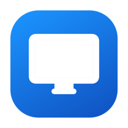
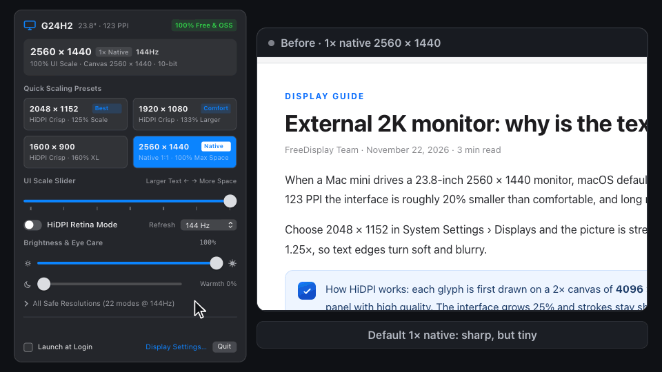

<div align="center">



<h1>FreeDisplay</h1>

<p><em>Bigger text on your external display, still pixel-sharp. One click, free and open source.</em></p>

<p>
  <a href="https://www.swift.org/"></a>
  <a href="https://www.apple.com/macos/"></a>
  <a href="https://developer.apple.com/xcode/swiftui/"></a>
  <a href="LICENSE"></a>
  <a href="https://github.com/acking-you/FreeDisplay/releases/latest"></a>
  <a href="https://github.com/acking-you/FreeDisplay/actions/workflows/ci.yml"></a>
  <a href="https://github.com/acking-you/FreeDisplay/stargazers"></a>
</p>

<p>
  <a href="README.md"><b>English</b></a> ·
  <a href="README.zh-CN.md">中文</a>
</p>



<sub>Illustration: the popover is redrawn from the app's layout; the screen patches are one page rendered each way and scaled onto a 2560 × 1440 panel the way macOS does it.</sub>

</div>

---

**FreeDisplay** makes everything on an external monitor bigger without making
it blurry. A 2560 × 1440 monitor runs at 1× by default: sharp, but small. When
System Settings offers only the 1× version of a smaller mode such as
2048 × 1152, choosing it stretches a smaller picture onto the panel and text
goes soft. FreeDisplay switches to the **HiDPI** version of that mode instead:
macOS draws on a canvas twice as wide and twice as tall, then scales it down to
the panel, so text and controls grow and stay sharp.

| Mode | macOS draws on | Reaches the 2560 × 1440 panel | Result |
| --- | --- | --- | --- |
| 1× native | 2560 × 1440 | pixel for pixel | sharp, but small |
| 1× 2048 × 1152 | 2048 × 1152 | stretched ×1.25 | bigger, but soft |
| **HiDPI 2048 × 1152** | **4096 × 2304** | **scaled down ×0.625** | **bigger and sharp** |

It lives in the menu bar, has a command line, keeps your refresh rate, and the
whole app is about 1.5 MB.

## What it does

- **One-click presets** — tiles for about 125%, 133% and 160% in HiDPI plus
  native 100%, worked out from the panel's own resolution. On a 2560 × 1440
  panel they are 2048 × 1152, 1920 × 1080, 1600 × 900 and 2560 × 1440.
- **Every mode macOS has, not only the ones System Settings lists** — a
  UI-scale slider over the modes with the panel's aspect ratio, a HiDPI
  switch, a refresh-rate menu, and a list of every safe mode at the current
  refresh rate with its canvas size (`freedisplay list` adds the other refresh
  rates and the color depth).
- **Your refresh rate stays** — changing the scale keeps the current refresh
  rate (144 Hz stays 144 Hz) whenever the new mode offers it, and prefers the
  variant with the deepest color.
- **A safety net for refresh rates** — a rate chosen from the refresh-rate
  menu holds for the session only; keep it within 10 seconds or the previous
  mode comes back. Resolution changes are saved and survive a restart.
- **Brightness and warmth** — brightness from 20 to 100% over DDC/CI when the
  monitor answers, through the display's gamma table otherwise, and a warm
  tint from 0 to 50% for the evening. Both are remembered and applied again
  after a display change.
- **A command line** — `freedisplay status | list | preset | set | brightness |
  reset`, for scripts and shortcuts.
- **Chinese and English** — the app and the CLI follow the macOS language;
  `--lang en` or `--lang zh` overrides it.
- **Small and local** — Swift, AppKit and SwiftUI with no dependencies; no
  helper daemon, no network access, no account. Launch at login uses the
  system's login-item service.

## How it works

macOS keeps a list of display modes for every monitor. Each entry has a
logical size (what apps lay out in), a backing size in pixels, a refresh rate
and flags; a HiDPI entry has twice the pixels of its logical size in each
direction, and WindowServer fits that canvas to the panel. System Settings
shows only part of the list. FreeDisplay reads all of it through SkyLight, the
private framework under CoreGraphics (`CGSGetNumberOfDisplayModes`,
`CGSGetDisplayModeDescriptionOfLength`), keeps the modes macOS marks as safe,
and applies one with `CGSConfigureDisplayMode` inside a CoreGraphics
display-configuration transaction. SkyLight is loaded with `dlopen` at run
time: no kernel extension, no driver, no SIP change.

Worth knowing:

- **FreeDisplay chooses among modes macOS already has.** It does not add
  resolutions: no EDID override, no virtual display. If
  `freedisplay list --hidpi` prints nothing for a monitor, macOS offers it no
  HiDPI mode and FreeDisplay cannot create one. Some Mac and display pairs get
  integer scaling only: a 2560 × 1440 monitor with just 1280 × 720 HiDPI
  (largest canvas 2560 × 1440) and nothing in between such as 2048 × 1152.
  The panel and `freedisplay status` say so; when reporting one, include the
  output of `freedisplay list --all`, which adds the modes macOS marks unsafe
  and their flags.
- **SkyLight is private API.** A macOS update can change it; if those calls go
  away, mode switching stops working until FreeDisplay is updated.
- **The CLI changes the main display.** `status` lists every display, and the
  popover has a display picker when more than one is connected.
- **Hardware brightness needs DDC/CI through `IOAVService`**, the route Apple
  silicon Macs use to talk to a monitor. Otherwise, and whenever warmth is on,
  brightness is a gamma table: it dims the picture, not the backlight, and
  other apps that write gamma tables (f.lux, calibration tools) can override
  it.

## Get started

**Download** `FreeDisplay-<version>.dmg` from
[Releases](https://github.com/acking-you/FreeDisplay/releases/latest), open it
and drag FreeDisplay to Applications. It is one app for Apple silicon and Intel
Macs with macOS 13 or later, signed with a Developer ID and notarized by Apple.
Start it, click the display icon in the menu bar, then a preset. For the
command line, link the app's binary onto your `PATH`:

```bash
ln -sf /Applications/FreeDisplay.app/Contents/MacOS/FreeDisplay /opt/homebrew/bin/freedisplay
```

**Or build it** with Swift 5.9 or later (Xcode 15, or the Command Line Tools):

```bash
git clone https://github.com/acking-you/FreeDisplay.git
cd FreeDisplay
./build.sh
```

`build.sh` builds a release binary, wraps it in `FreeDisplay.app` with a
generated icon, signs it ad hoc for this Mac, replaces
`/Applications/FreeDisplay.app` (quitting a running copy first), links the CLI
to `/opt/homebrew/bin/freedisplay` when that directory exists, and starts the
app. `./build.sh --universal --no-install` only packages a universal
`dist/FreeDisplay.app`.

From the terminal:

```bash
freedisplay status                         # displays, current mode, HiDPI canvas, refresh rate
freedisplay list --hidpi                   # HiDPI modes macOS offers for the main display
freedisplay list --all                     # also the modes macOS marks unsafe, with flags, for bug reports
freedisplay preset 125                     # 125 | 133 | 160 | 100
freedisplay set 2048x1152 --hidpi --hz 144
freedisplay brightness 80                  # 20–100
freedisplay reset                          # brightness back to 100%, warmth off
```

`freedisplay` with no command opens the app; `--silent` starts it in the menu
bar without the window.

## Development

All of the app is in `Sources/FreeDisplay/`: `SkyLightEngine.swift` reads and
applies display modes and works out the presets, `DisplayViewModel.swift`
holds the app state and the refresh-rate safety net, `MenuBarPopoverView.swift`
is the SwiftUI panel shared by the popover and the window,
`BrightnessController.swift` handles DDC/CI and the gamma table, and
`CLI.swift`, `Localization.swift` and `main.swift` cover the command line, the
two languages and startup. `build.sh` packages and installs the app. CI builds
every push and pull request, and a `vX.Y.Z` tag publishes a signed, notarized
DMG through `scripts/release/macos_package.py` ([changelog](CHANGELOG.md)). The
rules a change must keep are in [AGENTS.md](AGENTS.md).

```bash
swift build -c release
.build/release/FreeDisplay status
```

## License

[MIT](LICENSE)
