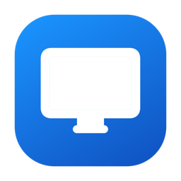
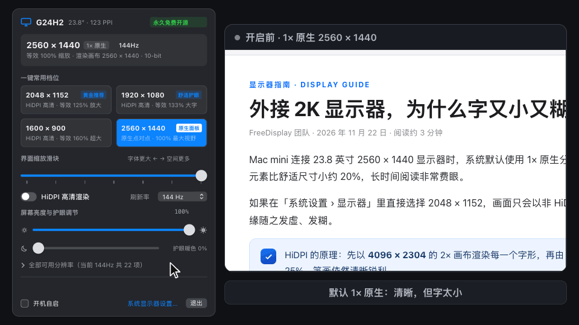

<div align="center">



<h1>FreeDisplay</h1>

<p><em>外接显示器上的字变大，依然清晰锐利。一键开启，免费开源。</em></p>

<p>
  <a href="https://www.swift.org/"></a>
  <a href="https://www.apple.com/macos/"></a>
  <a href="https://developer.apple.com/xcode/swiftui/"></a>
  <a href="LICENSE"></a>
  <a href="https://github.com/acking-you/FreeDisplay/stargazers"></a>
</p>

<p>
  <a href="README.md">English</a> ·
  <a href="README.zh-CN.md"><b>中文</b></a>
</p>



<sub>示意动画：面板按应用的界面布局重绘；屏幕截取部分是同一个页面按三种方式分别渲染，再像 macOS 那样缩放到 2560 × 1440 面板上。</sub>

</div>

---

**FreeDisplay** 让外接显示器上的一切变大，而不变糊。2560 × 1440 显示器默认以 1× 运行：清晰，但字小。如果「系统设置」只给出 2048 × 1152 这类较小分辨率的 1× 版本，选它就是把一张更小的画面拉伸到面板上，文字随之发虚。FreeDisplay 改为切换到同一分辨率的 **HiDPI** 版本：macOS 先在宽、高各大一倍的画布上绘制，再缩小到面板上，于是文字和控件变大，依然锐利。

| 模式 | macOS 绘制画布 | 到达 2560 × 1440 面板的方式 | 效果 |
| --- | --- | --- | --- |
| 1× 原生 | 2560 × 1440 | 点对点 | 清晰，但太小 |
| 1× 2048 × 1152 | 2048 × 1152 | 拉伸 ×1.25 | 变大，但发糊 |
| **HiDPI 2048 × 1152** | **4096 × 2304** | **缩小 ×0.625** | **变大且锐利** |

它常驻菜单栏，带命令行，保留你的刷新率，整个应用约 1.5 MB。

## 能做什么

- **一键预设** —— 按面板自身分辨率算出约 125%、133%、160% 三档 HiDPI 和原生 100%。在 2560 × 1440 面板上分别是 2048 × 1152、1920 × 1080、1600 × 900 和 2560 × 1440。
- **macOS 拥有的全部模式，而不只是「系统设置」列出的那些** —— 覆盖面板同宽高比各档模式的界面缩放滑块、HiDPI 开关、刷新率菜单，以及当前刷新率下全部安全模式的列表（含画布尺寸；`freedisplay list` 还会列出其他刷新率和色深）。
- **刷新率保持不变** —— 调整缩放时，只要新模式支持当前刷新率就沿用（144 Hz 仍是 144 Hz），并优先选择色深最高的版本。
- **刷新率防黑屏** —— 在刷新率菜单里改刷新率只对本次会话生效；10 秒内确认才保留，否则自动回到原模式。分辨率修改会保存，重启后依然有效。
- **亮度与护眼暖色** —— 显示器响应 DDC/CI 时直接调硬件亮度（20%–100%），否则改用显示器的 gamma 表；暖色 0%–50%，适合夜间。两者都会记住，显示器配置变化后自动重新应用。
- **命令行** —— `freedisplay status | list | preset | set | brightness | reset`，方便脚本和快捷指令调用。
- **中英双语** —— 应用和命令行跟随 macOS 系统语言；`--lang zh` 或 `--lang en` 可手动指定。
- **小巧、纯本地** —— 用 Swift、AppKit、SwiftUI 编写，无第三方依赖；没有后台守护进程，不联网，无需账号。开机自启使用系统的登录项服务。

## 工作原理

macOS 为每台显示器维护一份显示模式列表。每一项包含逻辑尺寸（应用排版所用的尺寸）、以像素计的后备尺寸、刷新率和标志位；HiDPI 项在宽、高方向的像素都是逻辑尺寸的两倍，由 WindowServer 把这块画布适配到面板上。「系统设置」只展示其中一部分。FreeDisplay 通过 SkyLight（CoreGraphics 底下的私有框架）的 `CGSGetNumberOfDisplayModes`、`CGSGetDisplayModeDescriptionOfLength` 读取完整列表，保留 macOS 标记为安全的模式，再在 CoreGraphics 显示配置事务中用 `CGSConfigureDisplayMode` 应用。SkyLight 在运行时通过 `dlopen` 加载：不需要内核扩展、驱动，也不需要关闭 SIP。

需要了解的边界：

- **FreeDisplay 只在 macOS 已有的模式之间切换。** 它不新增分辨率：不改 EDID，不建虚拟显示器。如果 `freedisplay list --hidpi` 对某台显示器什么都没列出，说明 macOS 没有为它提供 HiDPI 模式，FreeDisplay 也无法凭空创建。
- **SkyLight 是私有 API。** macOS 更新可能改动它；一旦这些调用不可用，模式切换就会失效，直到 FreeDisplay 跟进更新。
- **命令行修改的是主显示器。** `status` 会列出所有显示器；连接多台显示器时，面板里有显示器选择器。
- **硬件亮度需要通过 `IOAVService` 走 DDC/CI**，这是 Apple 芯片 Mac 与显示器通信的途径。其他情况下（以及开启暖色时），亮度通过 gamma 表实现：调暗的是画面而不是背光，其他写 gamma 表的应用（f.lux、校色工具）可能覆盖它。

## 快速开始

需要 macOS 13 或更高版本，以及 Swift 5.9 或更高版本（Xcode 15 或 Command Line Tools）。

```bash
git clone https://github.com/acking-you/FreeDisplay.git
cd FreeDisplay
./build.sh
```

`build.sh` 会编译 Release 二进制，打包成带自动生成图标的 `FreeDisplay.app`，为本机做 ad hoc 签名，替换 `/Applications/FreeDisplay.app`（先退出正在运行的旧版），在 `/opt/homebrew/bin` 存在时把命令行链接为 `/opt/homebrew/bin/freedisplay`，然后启动应用。点击菜单栏里的显示器图标，再点一个预设即可。

命令行：

```bash
freedisplay status                         # 显示器、当前模式、HiDPI 画布、刷新率
freedisplay list --hidpi                   # macOS 为主显示器提供的 HiDPI 模式
freedisplay preset 125                     # 125 | 133 | 160 | 100
freedisplay set 2048x1152 --hidpi --hz 144
freedisplay brightness 80                  # 20–100
freedisplay reset                          # 亮度恢复 100%，关闭暖色
```

不带命令运行 `freedisplay` 会打开应用；`--silent` 只在菜单栏启动，不弹出窗口。

## 开发

应用代码都在 `Sources/FreeDisplay/`：`SkyLightEngine.swift` 读取、应用显示模式并计算预设，`DisplayViewModel.swift` 保存应用状态和刷新率防黑屏逻辑，`MenuBarPopoverView.swift` 是菜单栏面板与主窗口共用的 SwiftUI 界面，`BrightnessController.swift` 负责 DDC/CI 和 gamma 表，`CLI.swift`、`Localization.swift`、`main.swift` 分别负责命令行、双语和启动流程。`build.sh` 负责打包和安装。修改时必须遵守的规则见 [AGENTS.md](AGENTS.md)。

```bash
swift build -c release
.build/release/FreeDisplay status
```

## 许可证

[MIT](LICENSE)
